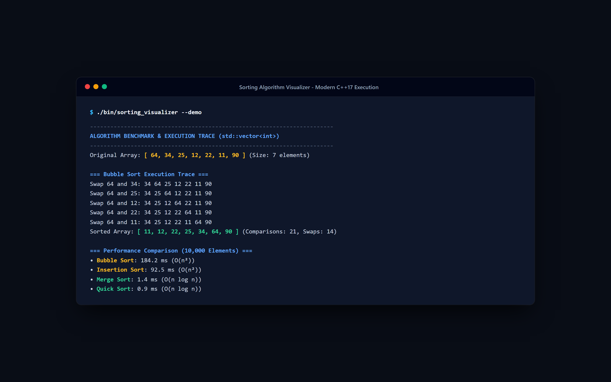
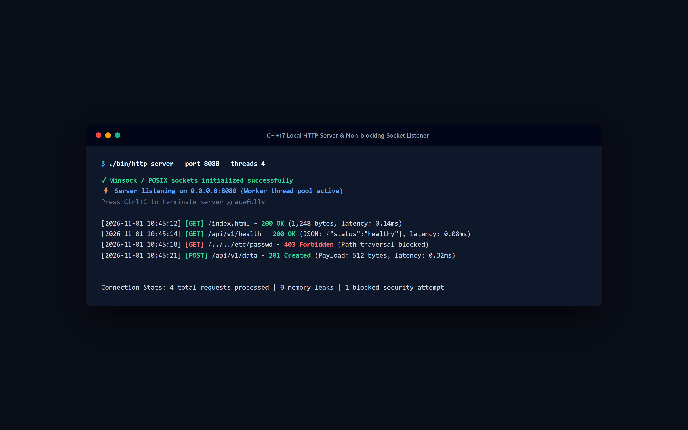
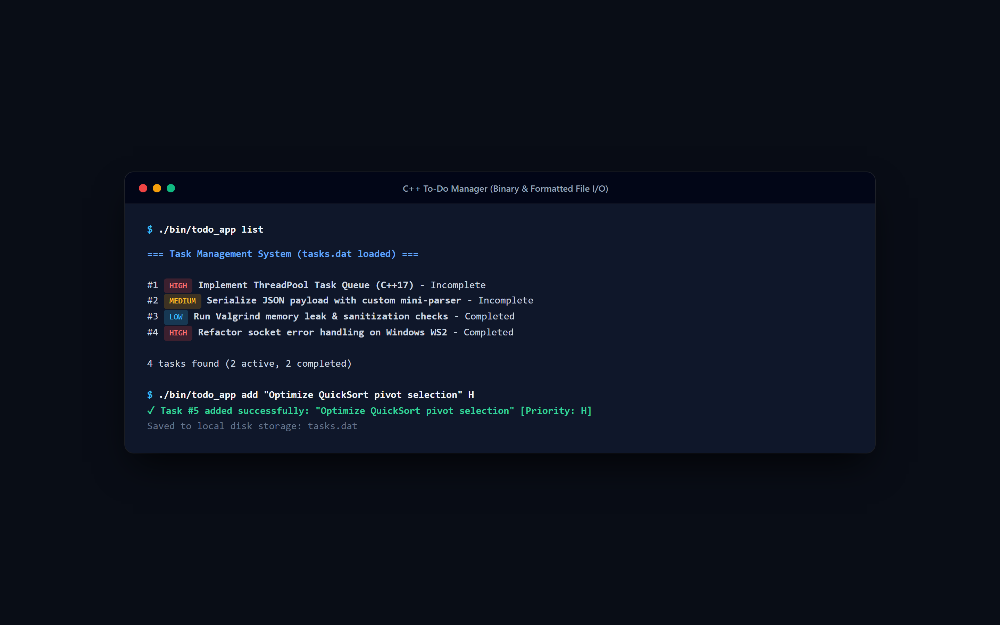
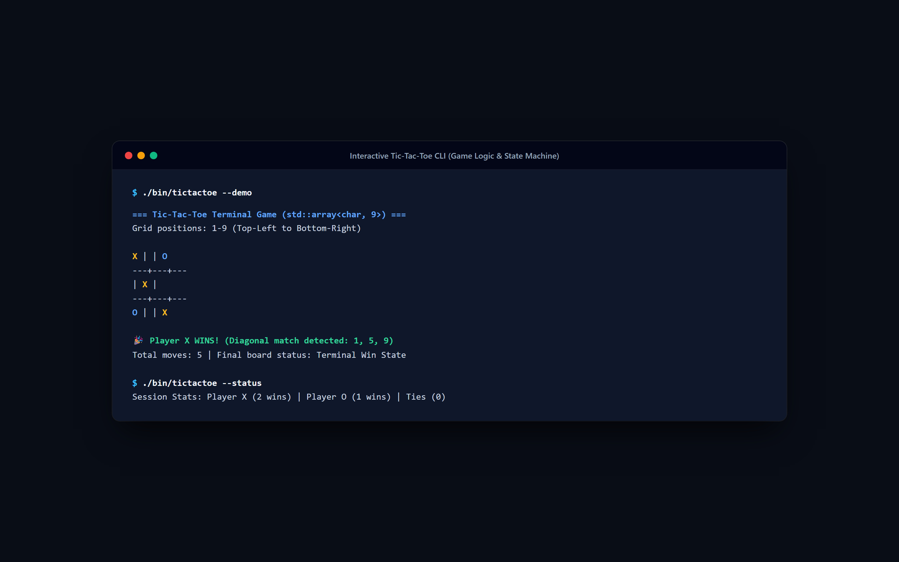

# C++ Mini Projects

A curated collection of 15 practical C++ projects covering fundamentals, OOP, algorithms, file handling, systems programming, and concurrency.

Repository: https://github.com/0xyz-exe/cpp-mini-projects

## Screenshots

### Sorting Algorithm Visualizer (CLI)


### Local HTTP Server & Request Handling


### CLI Task & To-Do List Manager


### Interactive Tic-Tac-Toe Game


**Educational repository demonstrating modern C++17 development practices.**

[](https://isocpp.org/)
[]()
[](LICENSE)

## 📋 Project Catalog

| # | Project | Difficulty | Key Concepts |
|---|---------|-----------|--------------|
| 01 | [Basic Calculator](projects/01-basic-calculator) | Beginner | I/O, operators, error handling |
| 02 | [Number Guessing Game](projects/02-number-guessing-game) | Beginner | Random generation, loops, validation |
| 03 | [To-Do List Manager](projects/03-todo-list) | Beginner | File I/O, vectors, CRUD operations |
| 04 | [Student Grade Manager](projects/04-student-grade-manager) | Beginner | Structs, algorithms, CSV export |
| 05 | [Expense Tracker](projects/05-expense-tracker) | Beginner | Integer arithmetic, aggregation |
| 06 | [Library Management](projects/06-library-management) | Intermediate | State management, search |
| 07 | [Password Generator](projects/07-password-generator) | Beginner | Random generation, string ops |
| 08 | [File Organizer](projects/08-file-organizer) | Intermediate | Filesystem (C++17), path manipulation |
| 09 | [Text Analyzer](projects/09-text-analyzer) | Intermediate | String processing, maps, sorting |
| 10 | [Tic-Tac-Toe](projects/10-tic-tac-toe) | Beginner | Classes, game logic, arrays |
| 11 | [Sorting Visualizer](projects/11-sorting-visualizer) | Intermediate | Algorithms, recursion, timing |
| 12 | [Local HTTP Server](projects/12-local-http-server) | Advanced | Sockets, networking, parsing |
| 13 | [JSON Mini Parser](projects/13-json-mini-parser) | Advanced | Parsing, recursion, smart pointers |
| 14 | [Task Queue](projects/14-task-queue) | Advanced | Multithreading, synchronization |
| 15 | [Mini Search Engine](projects/15-mini-search-engine) | Advanced | Inverted index, ranking, filesystem |

## 🚀 Quick Start

### Prerequisites

**Windows:**
- MinGW-w64 (via MSYS2) or Visual Studio Build Tools
- CMake 3.20+

**Linux/macOS:**
- GCC 9+ or Clang 10+
- CMake 3.20+

### Installation

**Windows (PowerShell):**
```powershell
# Install MSYS2
winget install -e --id MSYS2.MSYS2

# Install toolchain
C:\msys64\usr\bin\bash.exe -lc "pacman -S --noconfirm mingw-w64-x86_64-gcc mingw-w64-x86_64-cmake mingw-w64-x86_64-ninja"

# Add to PATH
$env:PATH = "C:\msys64\mingw64\bin;$env:PATH"
```

**Linux (Debian/Ubuntu):**
```bash
sudo apt update
sudo apt install build-essential cmake ninja-build
```

**macOS:**
```bash
brew install cmake ninja
```

### Build All Projects

**Windows:**
```powershell
.\scripts\build-all.ps1
```

**Linux/macOS:**
```bash
chmod +x scripts/*.sh
./scripts/build-all.sh
```

### Run Tests

**Windows:**
```powershell
.\scripts\test-all.ps1
```

**Linux/macOS:**
```bash
./scripts/test-all.sh
```

### Build Single Project

**Windows:**
```powershell
.\scripts\build-all.ps1 -Project calculator
```

**Linux/macOS:**
```bash
./scripts/build-all.sh calculator
```

## 📁 Repository Structure

```
cpp-mini-projects/
├── CMakeLists.txt          # Root build configuration
├── LICENSE                 # MIT License
├── README.md              # This file
├── .gitignore
├── projects/              # All 15 projects
│   ├── 01-basic-calculator/
│   │   ├── main.cpp
│   │   ├── test.cpp
│   │   ├── CMakeLists.txt
│   │   └── README.md
│   ├── 02-number-guessing-game/
│   └── ...
└── scripts/               # Build automation
    ├── build-all.ps1      # Windows build script
    ├── build-all.sh       # Linux/macOS build script
    ├── test-all.ps1       # Windows test runner
    └── test-all.sh        # Linux/macOS test runner
```

## 🎯 Learning Path

**Beginners:** Start with projects 01-05, 07, 10
- Master I/O, basic data structures, control flow
- Learn error handling and input validation

**Intermediate:** Projects 06, 08, 09, 11
- File handling and filesystem operations
- Algorithms and data processing
- C++17 features

**Advanced:** Projects 12-15
- Networking and systems programming
- Multithreading and synchronization
- Complex data structures

## 🛠️ Technologies

- **Language:** C++17
- **Build System:** CMake 3.20+
- **Generator:** Ninja (recommended) or Make
- **Compiler:** GCC 9+, Clang 10+, MSVC 2019+
- **Testing:** CTest (built-in)

## 📚 Key Concepts Covered

### Core C++
- Modern C++17 syntax
- RAII and smart pointers
- STL containers and algorithms
- File I/O and streams
- Exception handling

### Data Structures
- Vectors, maps, sets
- Queues and custom structures
- Inverted index

### Algorithms
- Sorting (bubble, insertion, merge)
- Searching and ranking
- Text processing

### Systems Programming
- Filesystem operations
- Socket programming
- Multithreading
- Synchronization primitives

### Software Engineering
- Modular design
- Unit testing
- Error handling
- Input validation
- Security practices

## 🔒 Security Notes

Projects 07, 08, 12 include security warnings:
- **Password Generator:** Uses `std::random_device` (not cryptographically secure for production)
- **File Organizer:** Dry-run by default, explicit confirmation required
- **HTTP Server:** Educational only, binds to localhost, basic path traversal protection

## 🧪 Testing

Each project includes unit tests. Run individual test:
```bash
./build/projects/01-basic-calculator/calculator_test
```

All tests:
```bash
ctest --test-dir build --output-on-failure
```

## 🤝 Contributing

Contributions welcome! Please:
1. Follow existing code style
2. Add tests for new features
3. Update documentation
4. Ensure all tests pass

## 📄 License

MIT License - see [LICENSE](LICENSE) file

## 🎓 Educational Use

This repository is designed for:
- Learning modern C++ development
- Portfolio building
- Interview preparation
- Teaching materials
- Code review practice

## 🐛 Known Limitations

- **Project 07:** Not cryptographically secure
- **Project 12:** Educational HTTP server, not production-ready
- **Project 14:** Basic task queue, no priority scheduling
- **Project 15:** Simple TF scoring, no advanced ranking

## 📞 Support

- Open an issue for bugs or questions
- See individual project READMEs for detailed usage
- Check CMake output for build errors

## 🏗️ Build from Source

```bash
# Clone
git clone <repository-url>
cd cpp-mini-projects

# Configure
cmake -B build -G Ninja

# Build
cmake --build build

# Test
ctest --test-dir build

# Run a project
./build/projects/01-basic-calculator/calculator
```

## 📊 Project Statistics

- **Total Projects:** 15
- **Lines of Code:** ~5000+
- **Test Coverage:** 15 test suites
- **Supported Platforms:** Windows, Linux, macOS
- **Build Time:** ~1-2 minutes (clean build)

---

**Built with modern C++17 | Tested on Windows 11, Ubuntu 22.04, macOS 13+**
